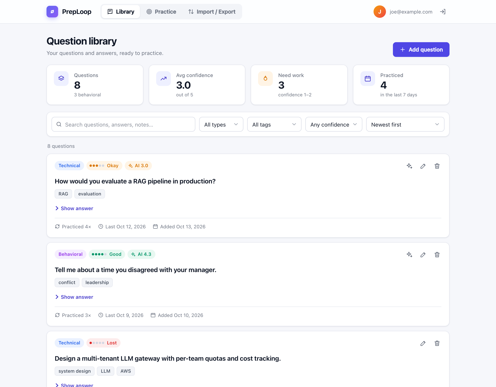
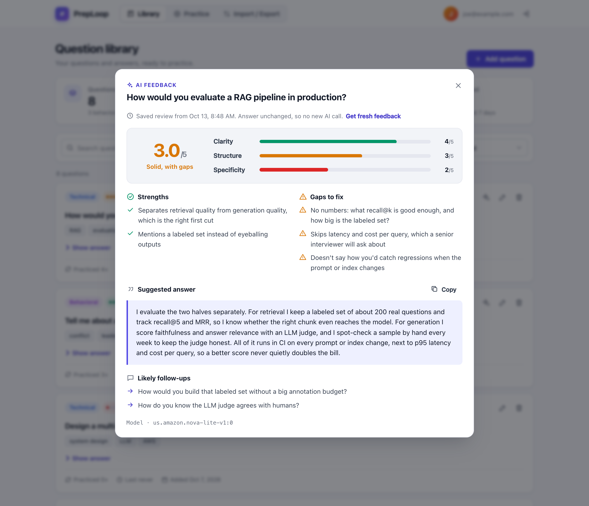
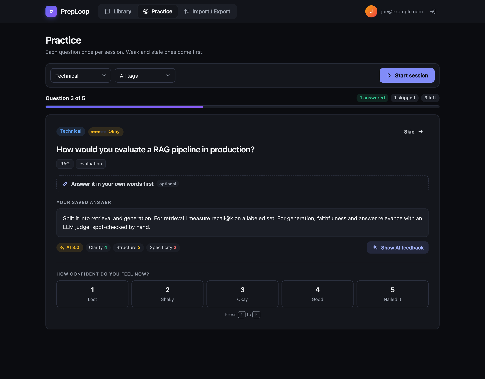
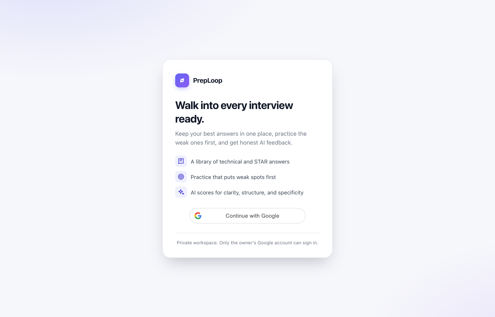
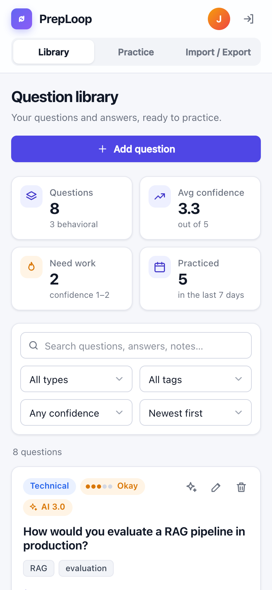
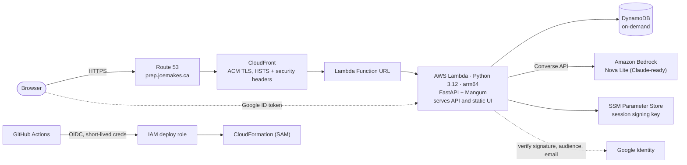
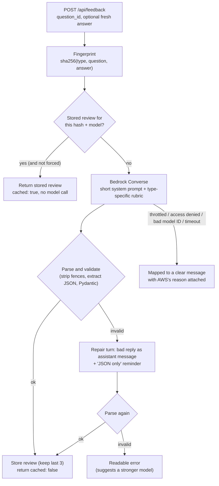

# PrepLoop

**An AI interview coach, built to production standards on serverless AWS.**
Store your interview answers, practice the weakest ones first, and get structured, model-graded feedback from Amazon Bedrock.

[](https://github.com/TianweiZhou/preploop/actions/workflows/ci-cd.yml)


**Live:** [prep.joemakes.ca](https://prep.joemakes.ca) (single-user: sign-in is locked to the owner's Google account, so the screenshots below use sample data)



---

## Contents

- [What it does](#what-it-does)
- [Engineering highlights](#engineering-highlights)
- [Architecture](#architecture)
- [The AI feedback pipeline](#the-ai-feedback-pipeline)
- [Design decisions and tradeoffs](#design-decisions-and-tradeoffs)
- [Security](#security)
- [Cost](#cost)
- [Testing and CI/CD](#testing-and-cicd)
- [Taking it to multi-tenant production](#taking-it-to-multi-tenant-production)
- [Run it yourself](#run-it-yourself)

---

## What it does

| | |
|---|---|
| **Question library** | Technical and behavioral questions with your own answers, STAR breakdowns, tags, and a 1 to 5 confidence score. Search, filter, and sort. |
| **Smart practice** | Sessions go through each matching question once, ordered by a weighting of low confidence and staleness, with a progress bar and keyboard shortcuts (`Space` to reveal, `1` to `5` to rate). |
| **AI feedback** | Scores clarity, structure, and specificity, lists strengths and gaps, writes a suggested answer in your voice, and predicts follow-up questions. Behavioral answers are checked against STAR; technical answers against what a senior interviewer expects. |
| **Import and export** | CSV or JSON in and out, with duplicate detection and per-row error reporting. An export doubles as a full backup, practice stats included. |

<table>
  <tr>
    <td width="58%"></td>
    <td width="42%"></td>
  </tr>
  <tr>
    <td align="center"><sub>AI feedback report: overall score, per-criterion bars, strengths, gaps, suggested answer</sub></td>
    <td align="center"><sub>Practice session (dark mode): progress, saved answer, latest AI scores</sub></td>
  </tr>
  <tr>
    <td></td>
    <td align="center"></td>
  </tr>
  <tr>
    <td align="center"><sub>Sign-in with Google, locked to the owner's account</sub></td>
    <td align="center"><sub>Responsive layout on a phone</sub></td>
  </tr>
</table>

---

## Engineering highlights

- **Model-agnostic LLM integration.** All inference goes through the Bedrock **Converse API**, so switching from Amazon Nova Lite to Claude is a single config change (`FEEDBACK_MODEL_ID`), with no code changes. The prompts are deliberately short and plain so small, cheap models follow them reliably.
- **Reliable structured output from small models.** JSON-only prompting, then a defensive parser (strips code fences and chatter, extracts the object, validates with Pydantic, coerces near-miss values like `"4"` or `3.6`), then **one conversational repair retry** that feeds the bad reply back with a stricter instruction. Failures surface as readable errors, never a 500.
- **Content-addressed caching of model output.** Each review is stored with a SHA-256 fingerprint of *(question type, question, answer text)* plus the model ID. Asking again about an unchanged answer returns the stored review without calling the model; editing the answer or switching models invalidates it automatically. The last three reviews per question are kept, which also enables side-by-side model comparison later.
- **Least-privilege IAM for cross-region inference.** The Lambda can invoke only the configured inference profile, and the underlying foundation models only *through* that profile (`bedrock:InferenceProfileArn` condition), so the profile's regional fan-out works without granting blanket model access.
- **Keyless CI/CD.** GitHub Actions deploys through **OIDC** with GitHub's immutable subject claim (`owner@id/repo@id`), so no AWS keys are stored and a renamed or re-created repo can't assume the role. The deploy role can only manage IAM roles prefixed with the stack name, and can't edit itself.
- **Infrastructure as code, end to end.** One SAM template creates the table, function, Function URL, and (when a domain is set) the ACM certificate with automatic DNS validation, the CloudFront distribution, and the Route 53 alias records.
- **Pragmatic, near-zero idle cost.** Scale-to-zero compute, on-demand storage, no NAT, no VPC, no always-on services. See [Cost](#cost).

---

## Architecture



**Request path:** the browser talks only to `prep.joemakes.ca`. CloudFront terminates TLS, adds security headers, and forwards everything (no caching, since every response is per-user) to the Lambda Function URL. A single Lambda runs FastAPI behind the Mangum ASGI adapter and serves both the JSON API and the static frontend, so there is no CORS surface. The frontend is plain HTML, CSS, and JavaScript with no build step.

**Auth:** Google Identity Services issues an ID token in the browser. The backend verifies its signature, audience, expiry, `email_verified`, and an exact email allow-list match, then issues its own 7-day session JWT in an `HttpOnly`, `Secure`, `SameSite=Strict` cookie, signed with a key held in SSM Parameter Store.

---

## The AI feedback pipeline



**Prompting.** A short system prompt fixes the role ("experienced interviewer, direct, not flattering") and the exact JSON shape. The user turn adds a rubric chosen by question type:

- *Behavioral:* check STAR structure, flag results that aren't measurable, flag a vague "we" where "I" belongs, keep the suggested answer to one or two minutes spoken.
- *Technical:* check accuracy and depth, flag errors and missing tradeoffs, say what a senior interviewer would expect.

The suggested answer is constrained to keep the candidate's own voice, avoid buzzwords, and avoid em dashes (also enforced in post-processing).

**Output contract** (validated with Pydantic, scores clamped to 1 to 5):

```json
{
  "scores": { "clarity": 4, "structure": 3, "specificity": 2 },
  "strengths": ["..."],
  "gaps": ["..."],
  "suggested_answer": "...",
  "follow_up_questions": ["..."]
}
```

**Provenance.** Every review records which model produced it and when; the UI shows the model ID, which makes Nova-vs-Claude comparisons honest.

**Error handling.** Bedrock errors are mapped to messages a user can act on: throttling (429), model access not enabled or IAM denial (with AWS's own reason passed through, e.g. an account still under verification), an unknown model or inference profile in the region, model unavailable, expired credentials, and timeouts. The Bedrock client uses a 25-second read timeout and one automatic retry for transient errors; the Lambda and CloudFront origin timeouts are both 60 seconds.

---

## Design decisions and tradeoffs

| Decision | Alternatives considered | Why |
|---|---|---|
| **Lambda Function URL** behind CloudFront | API Gateway (REST or HTTP API) | No per-request API Gateway cost and fewer moving parts. Auth lives in the app; throttling is covered by Lambda concurrency limits, and CloudFront adds Shield Standard. API Gateway (or WAF) is the upgrade path if rate limiting becomes a requirement. |
| **One Lambda serving API and UI** | S3 + CloudFront for static, separate API | Same origin means no CORS, one deploy unit, one cookie domain. At this scale the extra Lambda invocations for static files are free. |
| **DynamoDB single table, full scan** | GSIs, RDS | Hundreds of items for one user: a scan plus filtering in Python is simpler and effectively free. Keys are `Q#<uuid>`, so adding a per-user partition key later is straightforward. |
| **Bedrock Converse API** | Model-specific `InvokeModel` payloads, a third-party SDK | One request shape across Nova, Claude, and others. Model choice becomes configuration. |
| **Google sign-in + own session JWT** | Amazon Cognito | Single user: verifying a Google ID token and issuing an HttpOnly cookie is less infrastructure and fewer failure modes. Cognito is the multi-user path. |
| **Cache reviews by content hash** | Always call the model; TTL cache | Feedback for an unchanged answer is deterministic enough to reuse. Hash-based keys invalidate exactly when the input or model changes, with no TTL guesswork. |
| **Route 53 for DNS** | Keep DNS at the registrar | The domain was new, so moving it cost nothing, and it lets the template create certificate validation and alias records automatically. The hosted zone lives outside the app stack so a teardown never changes nameservers. |
| **No frontend framework or build step** | React, Vite | The UI is a few views. Plain JavaScript keeps the deploy a single artifact and the page fast. User content is escaped at every render site. |
| **arm64 Lambda** | x86_64 | Lower price per GB-second; all dependencies ship aarch64 wheels. |

---

## Security

- **Authentication on every data route.** Only health, config, login, and logout are public. Sessions are 7-day JWTs in `HttpOnly` + `Secure` + `SameSite=Strict` cookies, re-checked against the allow-listed email on each request.
- **Token verification is server-side.** Signature, audience (the app's client ID), expiry, `email_verified`, and an exact email match. Any other Google account gets a 403.
- **Least-privilege IAM.** The function can read/write only its own table, read only its own SSM parameter, and invoke only the configured model (see [highlights](#engineering-highlights)).
- **Secrets stay out of the repo and the logs.** The signing key is a SecureString in SSM; deploy settings are GitHub secrets (masked in public Actions logs); local `.env` and `samconfig.toml` are gitignored and kept out of the Lambda package.
- **Edge hardening.** HTTPS only (HTTP redirects), TLS 1.2+, HSTS, `X-Content-Type-Options`, `X-Frame-Options`, and `Referrer-Policy` via CloudFront's managed security headers policy.
- **Input and output safety.** Pydantic validation with length limits on every field, a 1 MB import cap, and HTML escaping of all user content in the UI.
- **No API docs in production** (`/docs` and `/openapi.json` are disabled).

---

## Cost

Designed to cost close to nothing when idle and very little in use. At personal-use volume:

| Service | Cost |
|---|---|
| Lambda, DynamoDB (on-demand), CloudFront, ACM | Within the AWS free tier |
| Route 53 hosted zone | $0.50 / month |
| Amazon Bedrock (Nova Lite) | Fractions of a cent per review; cached reviews cost nothing |
| GitHub Actions | Free for this repo |

Total: **under $1 a month**. The main cost lever, LLM calls, is controlled by the review cache and by choosing a small model by default.

---

## Testing and CI/CD

**70 tests** (pytest) run in about 4 seconds with no network access:

- **Auth:** valid login and cookie flags, wrong email, unverified email, wrong audience, garbage tokens, tampered, expired, and wrong-user sessions.
- **Data:** CRUD, validation limits, tag cleanup, filters, search, sorting (DynamoDB mocked with `moto`).
- **LLM layer:** parsing of messy model output (code fences, preambles, string and float scores), rejection of malformed output, the repair retry, error mapping for five Bedrock error codes, prompt content per question type (Bedrock mocked).
- **Caching:** reuse for an unchanged answer, invalidation on edit, forced refresh, no reuse across models, history cap, and typed practice answers not evicting the saved answer's review.
- **Practice:** weighting order and range, a 2,000-draw distribution check, and full sessions visiting each question exactly once.
- **Import and export:** CSV and JSON round trips (quotes, commas, newlines, practice stats), duplicates, per-row errors, size limit, Excel BOM.

**Pipeline** (`.github/workflows/ci-cd.yml`): every push and pull request runs the tests and `sam validate --lint`. Pushes to `main` that pass are built and deployed with SAM through the OIDC role, then a health check hits the live domain. Deploys are serialized, and a failing test blocks the deploy.

---

## Taking it to multi-tenant production

What I would change to serve many users, roughly in priority order:

1. **Identity and tenancy.** Cognito user pools (or an enterprise IdP via OIDC/SAML); partition DynamoDB by `USER#<id>` with GSIs for tag and practice queries instead of scans; enforce tenant isolation in the data layer, not just the route layer.
2. **Prompt and model evaluation.** A versioned prompt registry, a golden set of answers with human scores, and an offline eval in CI that checks the model's scores agree with human ones before any prompt or model change ships. Store the prompt version with each review.
3. **Guardrails and abuse controls.** Bedrock Guardrails for content filtering, per-user quotas on model calls, API Gateway or WAF rate-based rules, and a monthly budget alarm.
4. **Observability.** Structured logs with request IDs, metrics for cache hit rate, parse-failure and retry rates, latency, and token usage per model; X-Ray tracing on the Bedrock call; alarms on error-rate spikes.
5. **Latency and long generations.** Stream responses (`ConverseStream`) for larger models, or move feedback to an async job (SQS + a worker Lambda) when generation can exceed the edge timeout.
6. **Retrieval-augmented feedback.** Ground the "what a senior interviewer expects" rubric in a curated knowledge base (Bedrock Knowledge Bases or OpenSearch Serverless) per topic.

---

## Run it yourself

```bash
python3.12 -m venv .venv && source .venv/bin/activate
pip install -r backend/requirements-dev.txt
cp .env.example .env            # fill in a Google OAuth client ID and your email
set -a; source .env; set +a
cd backend && uvicorn app.main:app --reload --port 8000
```

`LOCAL_MOCK_DB=1` (the default in `.env.example`) runs an in-memory DynamoDB, so you need no AWS account to try the app; set `AWS_PROFILE` to get real AI feedback from Bedrock. Run the tests with `cd backend && pytest -q`.

Deploying to your own AWS account, the custom domain, and the CI/CD setup are covered step by step in **[docs/OPERATIONS.md](docs/OPERATIONS.md)**.

### Repository layout

```
preploop/
  template.yaml                 # SAM: table, function, URL, cert, CloudFront, DNS
  infra/github-deploy-role.yaml # OIDC deploy role for GitHub Actions (deployed once)
  .github/workflows/ci-cd.yml   # test on every push/PR, deploy main
  backend/
    app/
      main.py                   # FastAPI app + Mangum Lambda handler
      auth.py                   # Google ID token verification, session cookie
      feedback.py               # Bedrock Converse, prompts, parsing, review cache
      db.py                     # DynamoDB access
      models.py                 # Pydantic models
      routes/                   # questions, practice, feedback, import/export
      static/                   # index.html, app.js, styles.css (no build step)
    tests/                      # 70 pytest tests
  scripts/seed_sample_data.py   # optional sample questions
  docs/                         # SPEC.md, OPERATIONS.md, screenshots
```

### Docs

- [docs/OPERATIONS.md](docs/OPERATIONS.md): local development, first deploy, custom domain, CI/CD setup, switching models
- [docs/SPEC.md](docs/SPEC.md): the original product spec this was built from

---

Built by **Joe Zhou** ([@TianweiZhou](https://github.com/TianweiZhou)).
